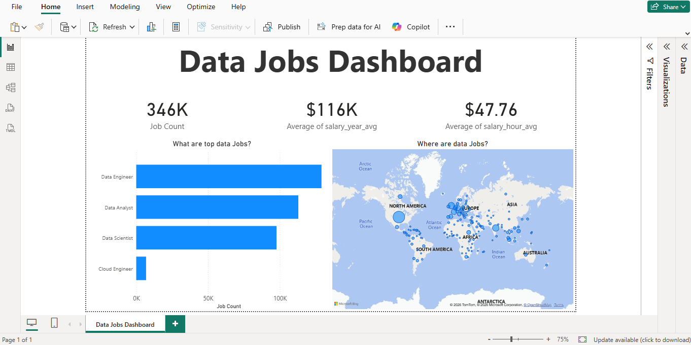
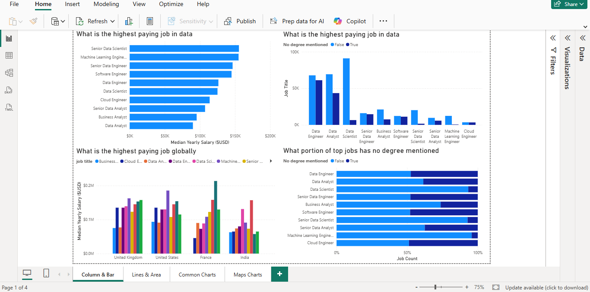
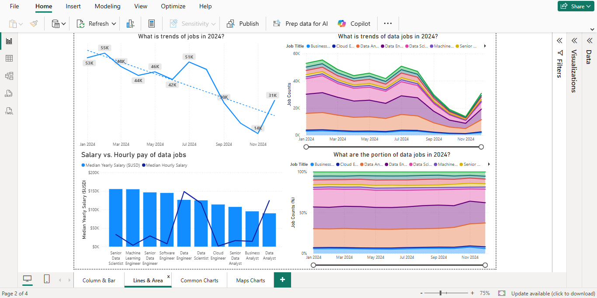
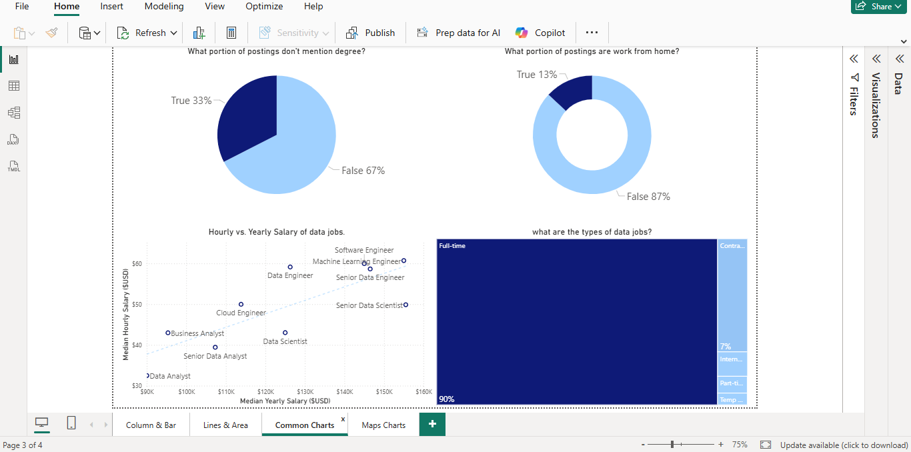
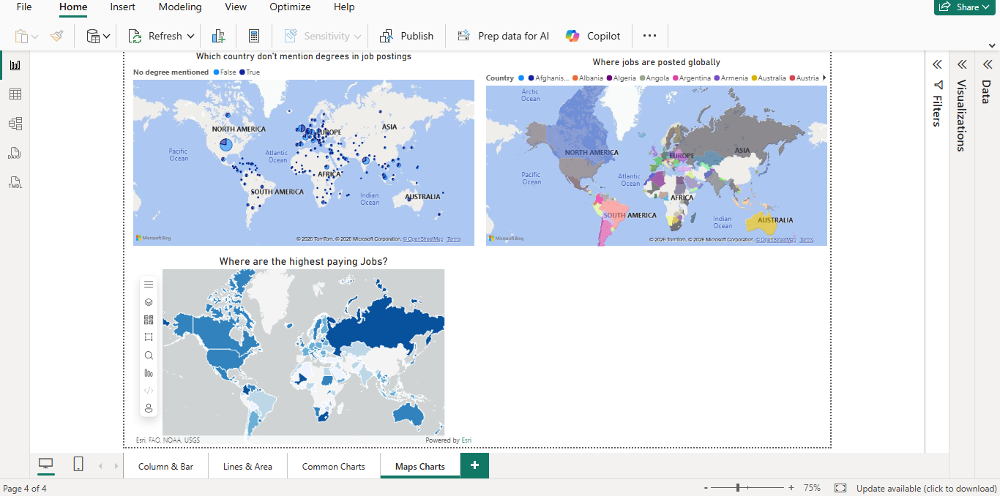

# Data Jobs Analytics in Power BI

Two Power BI projects built on almost 479,000 data-related job postings from 2024. The first is a summary dashboard. The second is a visualisation showcase that explores the same data across 15 charts on four pages.

## Why I built this

I am a Computer Science graduate starting a career in data and analytics. Instead of guessing which roles and skills to focus on, I used real job-market data to answer the questions a job seeker would ask:

- Which data roles are employers hiring for most?
- Where are the jobs and what do they pay?
- How many roles are remote, and how many ask for a degree?
- How did job postings change through 2024?

## Dataset

- **Name:** job_postings_flat.csv
- **Source:**  https://drive.google.com/file/d/1xiNSeNRKiuTrCDmJbDo3ukom47HaBeQj/view?usp=drive_link
- **Size:** 478,895 job postings, 17 columns
- **Period:** 1 January 2024 to 31 December 2024
- **Coverage:** 161 countries and 10 job categories (for example Data Analyst, Data Engineer, Data Scientist, Business Analyst and Machine Learning Engineer)

## Repository contents

| File | Description |
|---|---|
| Data_Jobs_Dashboard.pbix | One-page summary dashboard |
| Data_Jobs_Visualisations.pbix | Four-page report exploring different chart types |
| images/ | Screenshots used in this README |

## Project 1: Data Jobs Dashboard

A one-page dashboard with a bar chart of the most advertised data roles, a map of where the jobs are, and KPI cards for headline figures.

## Project 2: Data Jobs Visualisations

| Page | Charts | Questions answered |
|---|---|---|
| Column and Bar | Bar, clustered column, 100% stacked bar | Which roles pay most, and which roles do not mention a degree |
| Lines and Area | Line, stacked area, 100% stacked area, combo | How postings and role mix changed through 2024, and how yearly and hourly pay compare |
| Common Charts | Pie, donut, treemap, scatter | Degree requirements, remote work, schedule types and the link between hourly and yearly pay |
| Maps | Bubble map, filled map, ArcGIS map | Where jobs are posted, which countries mention degrees, and where the highest paying jobs are |

## Key insights

1. **Data Engineer is the most advertised role** with 128,994 postings, followed by Data Analyst (112,866) and Data Scientist (97,664).
2. **The United States has about 29% of all postings** (roughly 140,000). India (39,263) and the United Kingdom (35,684) follow.
3. **Senior and specialist roles pay the most.** Among postings that state a salary, the median yearly pay is about $155,500 for Senior Data Scientists and $155,000 for Machine Learning Engineers, compared with $90,000 for Data Analysts.
4. **Degree requirements vary a lot by role.** Only 4.3% of Machine Learning Engineer and 6.7% of Data Scientist postings omit a degree, compared with 38.5% for Data Analyst and 47.4% for Data Engineer.
5. **Most jobs are full-time.** Full-time roles make up 82.1% of postings and contractor roles 6.0%.
6. **Remote work is a minority.** About 13.2% of postings are work-from-home roles.
7. **Pay differs by country.** In the United States the median yearly salary is $112,500 (16,205 postings with salary), compared with $80,000 in India (389 postings).

## Limitations

- Only about 4% of postings include a yearly salary and about 2% an hourly salary, so pay results describe a small share of the data.
- Posting volume falls sharply in the last quarter (63,591 postings, compared with 156,645 in the first quarter). This is more likely a data collection effect than a real market change, so I did not draw conclusions from monthly trends.
- Some countries show unusually high counts compared with their job markets, which may reflect how the postings were collected rather than real demand.

## Tools used

- Power BI Desktop (data model, visuals and layout)
- Power Query (CSV import, header promotion and data type setting)

## How to open the files

1. Download the .pbix files from this repository.
2. Open them in Power BI Desktop (free from Microsoft).
3. If Power BI asks for the data source, point it to your local copy of `job_postings_flat.csv`.

## What I learned

- Cleaning and typing a large dataset (nearly half a million rows) in Power Query.
- Choosing the right chart and the right measure for each question, for example medians instead of totals for salary.
- Being open about data limits so that readers do not over-trust incomplete fields.

## Contact

**Sarah Appiah (Kukua)**
LinkedIn:linkedin.com/in/sarah-appiah-580881266 | Portfolio website link:https://sarah-appiah-portfolio.netlify.app | Email:sarah.n.appiah@gmail.com
